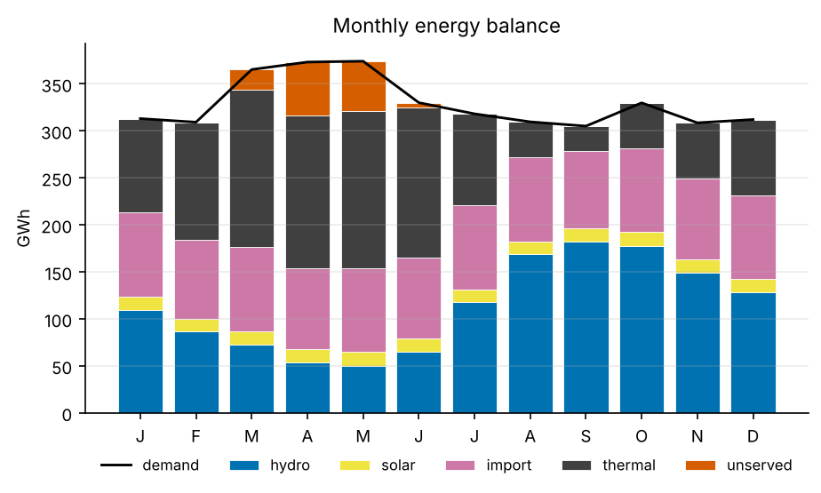
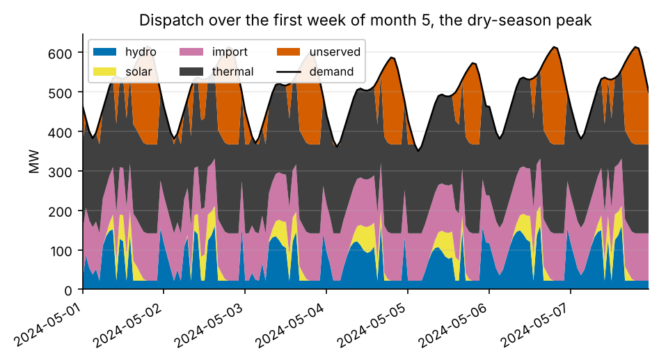
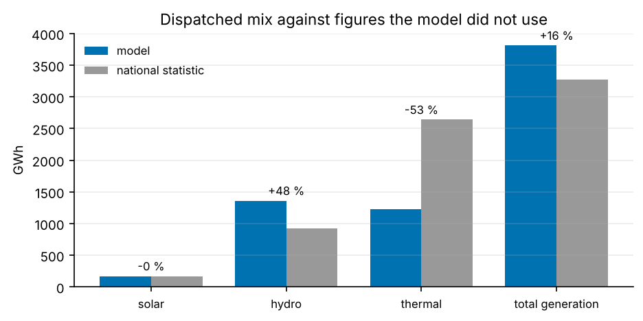

# Mali PyPSA model — version 0.1

A single-node least-cost dispatch model of the Malian power system, built on the
shared catalogue in `simulation/core`. Everything it knows about the fleet, the
demand and the sun comes from that catalogue, so this model and the power-flow
studies in the sibling branches describe the same country rather than two
similar ones.

```bash
pip install -e ../core -e .
mali-pypsa solve --figures          # dispatch, tables, report, figures
mali-pypsa validate                 # against data the model did not use
mali-pypsa compare                  # both import bases
mali-pypsa cutout --year 2024       # ERA5, needs a Copernicus account
```

Current PyPSA declares `pandas>=3.0` and current pandapower declares
`pandas~=2.3`, so installing this package beside the sibling in
`simulation/pandapower` — which `mali-pypsa validate` does, to compare the two
models — leaves pip with an unsatisfiable pair and a warning. Both run
correctly on pandas 2.3 and the suite passes there; install them one at a time
rather than in a single resolve, which is what the workflow does. Installing
this package on its own takes the newer pandas and the warning does not arise.

## Scope

Stated so that what the model does *not* do is as clear as what it does.

| In scope | Out of scope, deferred to a later version |
|---|---|
| One node (copper plate) | Transmission network and losses — `sim/pandapower` has that |
| EDM-SA generation fleet, as commissioned | Capacity expansion and investment |
| Annual hourly demand profile | Multi-year horizons, demand growth |
| Solar resource, hourly | Wind, and any other new resource |
| Least-cost economic dispatch | Unit commitment, start-up costs, minimum up and down times |
| Run-of-river limited hour by hour; reservoirs by a monthly energy budget | Reservoir optimisation against an inflow time series, and storage across months |

Version 0.1 is the floor, not the ambition: a model small enough that every
number in it can be traced, so that later versions have something to be checked
against.

## Result, 2024

Hourly, 8784 snapshots, imports at the contracted level, resource from the
clear-sky model in `simulation/core` (no Copernicus credentials in this
environment). Every figure below has its data beside it in `results/`.

| | |
|---|---|
| Demand (generation required) | **3 948 GWh**, peak 604 MW |
| Unserved | **136 GWh — 3.5 %**, over 1 505 hours |
| Operating cost | **285 M USD**, 74.7 USD/MWh served |
| Emissions | **813 kt CO₂**, 0.213 kg/kWh |
| Mix | hydro 1 361 · thermal 1 230 · import 1 051 · solar 170 GWh |



The shape of the Malian year is the result. Hydro falls from 182 GWh in
September to 50 GWh in May while demand climbs into the hot months, and
everything that is not water is either bought from Côte d'Ivoire at a fixed
contracted volume or burnt. All 136 GWh of unserved energy falls in February to
June; from July to January the model sheds nothing at all.

### Demand is generation required, not consumption

A copper plate has no network and therefore computes no losses. If demand were
set to what customers consume, the model would generate about a fifth less
energy than the system really does and every fuel bill and emission figure
would be understated by that fifth, while still solving cleanly. So demand here
carries the transmission and distribution losses inside it, because there is
nowhere else for them to be. This is the single most consequential choice in
the model and it is why the totals are not directly comparable with the
sibling studies, which have a network to put losses in.

## Two findings

### Mali's dry season is short of energy, not of power

Reservoir plants are limited by a monthly energy budget rather than by an
hourly ceiling — see below — so Manantali and Sélingué are free to open to
Mali's full entitlement for the evening peak. That freedom is worth 37 GWh of
avoided shedding. What it cannot do is create water: in April and May the
month's budget is spent and a third of the hours still shed load, so moving a
megawatt hour from one of those hours to another changes nothing.



The restlessness of the hydro band in that figure is the linear programme
being indifferent, not the river. Thermal sits flat against its availability
ceiling all week; the orange is what nobody can supply.

### The contracted import, not the line, is what rations supply

The interconnection to Côte d'Ivoire is rated well above the volume actually
contracted. Running the same year on both assumptions:

| Import basis | Unserved | Hours | Operating cost | CO₂ |
|---|---|---|---|---|
| contracted | 136 GWh (3.4 %) | 1 976 | 285 M USD | 813 kt |
| line rating | 6 GWh (0.2 %) | 236 | 269 M USD | 495 kt |

Shedding falls by 95 %, emissions by 39 %, and the cost of serving a megawatt
hour by 9 %. Whether that headroom is real depends on what is available on the
Ivorian side and on the commercial arrangement, neither of which this model
knows. It is reported as the gap between two stated assumptions, not as a
recommendation.

## Validation

A model calibrated on a statistic cannot be validated against it. The demand
level here comes from the national electricity balance, so reproducing total
demand proves nothing. What can be checked is the *composition* the optimiser
chose, because nothing told it how much of the year should come from hydro,
thermal or solar — that fell out of the merit order, the river and the sun.



| Quantity | Model | National statistic | Deviation |
|---|---|---|---|
| Solar | 169.8 GWh | 170.0 GWh | **−0.1 %** |
| Hydro | 1 361 GWh | 920 GWh | +48 % |
| Thermal | 1 230 GWh | 2 640 GWh | −53 % |

**Solar is a real check and it passes.** The resource model, the plant list and
the capacity factors were all built without reference to that figure, and they
land on it within a fifth of a per cent.

**Hydro at +48 % is an open problem, and it is a data problem.** The model
dispatches every megawatt hour the monthly availability table and Mali's OMVS
share allow, because water is the cheapest thing in the merit order. Either the
availability table is too generous — it is marked `estimated`, derived from
design energies rather than from operating records — or the real plants are not
run to their limit. Measured OMVS production data will decide it, and until
then every hydro figure here should be read as an upper bound.

**Thermal at −53 % is mostly a definitional gap.** The national fossil figure
includes the captive diesel plant of the gold mines, which is not on the
interconnected network at all. The utility share used to adjust for it is an
assumption and the comparison inherits its uncertainty.

**The national net-import line is not a reference for this model's import
variable**, and the comparison is refused rather than made. Manantali stands on
Malian soil, so its Senegalese and Mauritanian shares appear as Malian exports
in national accounts, whereas this model simply never gives Mali that energy.

### Against the sibling model

`mali-pypsa validate` also runs the chronological study in `sim/pandapower` on
the same catalogue and tabulates both. A merit-order dispatch followed by an AC
load flow and a linear programme are different machinery reaching the same
question:

| | Demand | Hydro | Solar | Thermal | Import | Unserved |
|---|---|---|---|---|---|---|
| pandapower | 3 534 | 1 361 | 169 | 1 272 | 755 | 131 |
| PyPSA | 3 948 | 1 361 | 170 | 1 230 | 1 051 | 136 |

Hydro agrees exactly, solar to within half a per cent, thermal to 3 %. The
import and demand columns differ because the two models use different demand
bases — the sibling works at network entry and computes transmission losses,
this one carries them inside demand — so the gap between the demand columns and
the gap between the import columns are the same 400 GWh seen twice.

## Three things the model does that stock PyPSA does not

**Reservoirs are limited by energy, not by power.** A reservoir does not limit
how much a plant can produce at any instant; it limits how much it can produce
over a season. Capping Manantali hour by hour at the month's mean availability
— 32 % of nameplate in May — gets both ends wrong: it hides the peak capacity
Mali actually has and spreads the water flat across hours that do not need it.
So Manantali and Sélingué carry a monthly energy budget, added to the
optimisation model as an explicit constraint, and may reach Mali's share of
nameplate in any hour. Félou, Gouina and Sotuba keep an hourly ceiling, because
their pondage is measured in hours and for them the river really is a power
limit. The budgets are set from the same availability table the ceiling used,
so the change moves energy about without creating any.

**Profiles are averaged over each snapshot's interval, not read at its start.**
A sampled year is the ordinary way to keep an optimisation tractable and the
ordinary way to get it wrong. Sampling a solar profile twelve-hourly reads a
capacity factor of zero at midnight and nearly eighty per cent at noon,
averaging to 0.39 against a true annual mean near 0.22 — a model that solves
cleanly and reports four fifths more solar than Mali can produce. Averaging
over the interval removes the bias and makes every annual total invariant to
the sampling interval, which is a property a reader can check and which is
tested. Beyond three hours a snapshot straddles sunrise; the diurnal checks
then say they are not applicable instead of failing.

**Nothing is quoted from a result that has not been checked.** Every run passes
through a set of assertions before a number leaves it: energy balance at every
snapshot, no generator above its availability, every reservoir month inside its
budget, the objective equal to the cost of what was dispatched, no solar at
night, and no load shed while usable capacity remained. The budget check exists
because a constraint that was never added is the one failure of this model with
no symptom — the dispatch looks reasonable and the reservoirs have quietly
produced more water than the river carries.

## Honest limits

- The solar resource is **modelled, not measured**. Without Copernicus
  credentials the model falls back on clear-sky geometry with a turbidity
  climatology, and says so in the provider field of every result. That
  describes a typical Malian year, not 2024. `mali-pypsa cutout` builds the
  ERA5 cutout where credentials exist, and the provider field then changes.
- **Minimum stable generation is recorded and not enforced.** A linear
  dispatch without unit commitment cannot represent a machine that is off, and
  a minimum applied anyway forces output from plant the optimiser would rather
  not run at all.
- **No reserve, no ramp rates, no outage schedule.** Thermal carries a flat
  8 % forced-outage allowance instead.
- **Water does not move between months.** The budget is monthly, so the model
  cannot carry the wet season into the dry one the way a real operator does.
- **No minimum release** is imposed on the reservoirs. In reality water passes
  for irrigation and navigation whether or not the power is wanted; here water
  is the cheapest energy available so the budget is spent in full regardless,
  and only its placement within the month would be affected.
- **Fuel prices and efficiencies are `estimated`**, not invoiced. The merit
  order they produce is robust — heavy fuel oil below diesel, both far above
  water — but the absolute cost figures move with them.

## Data provenance

Every data row in `data/reference/` carries a `source` and a `confidence` in
`measured`, `reported`, `derived` or `estimated`; the loaders refuse a row
without them. The confidence column is reproduced in `results/fleet.csv` and
`results/merit_order.csv` so that no figure can be read without it.

## Tests

```bash
pytest
```

145 tests. They cover the arithmetic of the cost table, the translation of each
physical limit into a constraint, the demand level and shape, the resource, the
network assembly, the dispatch and its checks, the validation, the report, the
figures and the command line. Several exist to catch a specific defect that was
found and fixed: a reservoir flattened to its monthly mean, a sampled year
losing four fifths of its solar bias, a budget constraint that was never added,
a provenance label read from the function called rather than from what it
returned.
